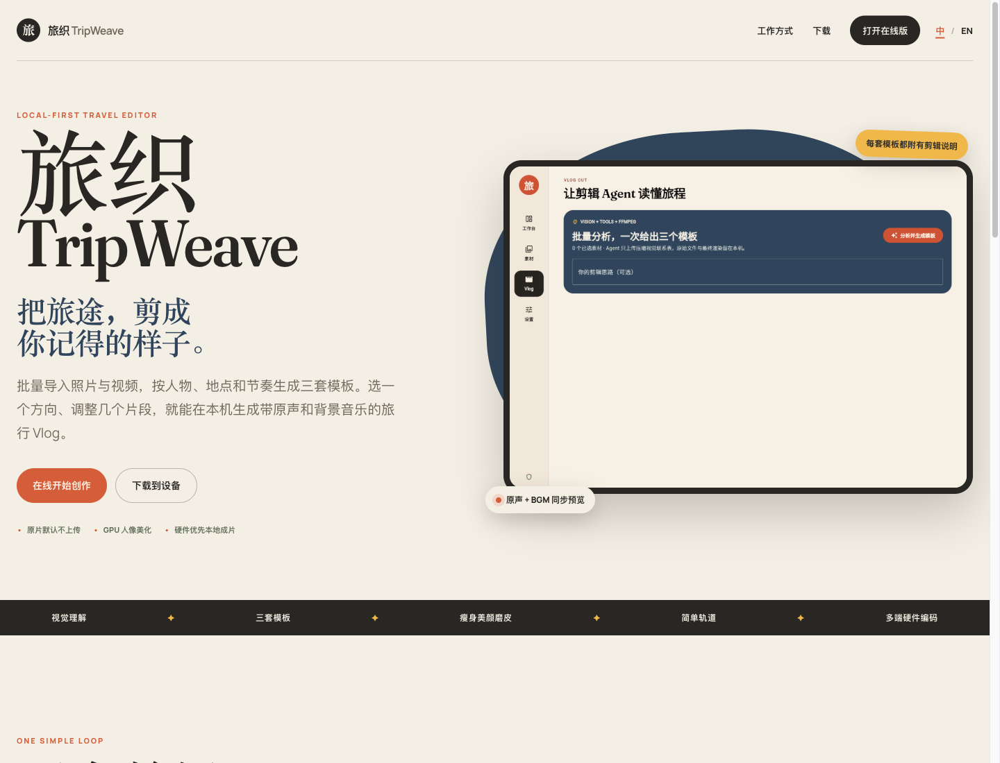

# 旅织 TripWeave

[](https://github.com/JimiZhou/tripweave/actions/workflows/ci.yml)
[](https://github.com/JimiZhou/tripweave/actions/workflows/release.yml)
[](LICENSE)

[在线体验](https://ai.jimizhou.com/tripweave) · [English](README_EN.md) · [架构](docs/ARCHITECTURE.md) · [配置说明](docs/CONFIGURATION.md) · [贡献指南](CONTRIBUTING.md)

TripWeave 是一款本地优先、面向普通旅行者的跨平台 Vlog 编辑器。批量导入照片和视频后，可以选择自动生成的三套方案，在同一页面调整片段、背景音乐和剪辑要求，最后通过硬件优先的 FFmpeg/WebCodecs 管线导出 MP4。

> 仓库只包含 Flutter 应用和构建配置，不包含运营后台、托管模型服务、私有 API、密钥或官网部署源码。`web/` 是 Flutter Web 平台入口，不是独立网站仓库。

## 界面

| 产品页面 | 编辑客户端 |
| --- | --- |
|  |  |

## 主要能力

- Android、Web、Windows、macOS 共用一套 Flutter 代码。
- 照片和视频批量多选；素材、人像处理和最终渲染默认留在设备上。
- GPU Runtime Fragment Shader 人像预设：自然美颜、磨皮、提亮和轻量塑形。
- 可选的 OpenAI-compatible 视觉与规划模型，支持同一个多模态模型或分别配置。
- ReAct 剪辑循环生成三套可解释模板，并允许用户输入修改要求重新编排。
- 紧凑预览、剪辑说明、时间轴、在线 CC0 音乐和片段区间在同一页面完成。
- 自动保存“已完成旅程”，保留模板、时间轴、音乐和修改要求。
- 硬件编码探测与真实短编码验证：MediaCodec、WebCodecs、NVENC/QSV/AMF、VideoToolbox。
- 硬件失败后自动回退 FFmpeg 软件编码，并使用 FFprobe 检查最终文件。

## 隐私边界

不启用模型时，完整创作链路不需要任何云端服务。主动分析素材时，应用只提交压缩视觉联系表和素材元数据；原视频不会由内置 Agent 上传。

开源版本没有默认模型地址、API Key、更新服务器或配置领取入口。模型配置由用户在设置页输入，并仅用于当前会话。详细说明见 [docs/CONFIGURATION.md](docs/CONFIGURATION.md)。

## 获取构建

- [在线版](https://ai.jimizhou.com/tripweave) 部署在独立服务器，公开仓库不包含官网或运营后台的私有部署配置。
- Android、Web ZIP、Windows 安装包，以及 Apple Silicon / Intel 两种 macOS ZIP，均由 [Build all clients](.github/workflows/release.yml) 在 GitHub 托管 runner 上生成。
- 打上 `v*` 标签后，工作流会创建 GitHub Release 并附加所有平台产物和 SHA-256。

正式发布包不会使用维护者本机产生的二进制。当前 Android 使用测试签名，macOS 使用临时签名且未公证；公开分发前可在自己的 fork 中接入平台签名凭证。

## 开发

环境要求：Flutter 3.44.2、Dart 3.12 或更高版本。

```bash
git clone https://github.com/JimiZhou/tripweave.git
cd tripweave
flutter pub get
flutter analyze
flutter test --exclude-tags=real-e2e
flutter run -d chrome
```

本地命令用于开发与调试；官方客户端只接受 GitHub Actions runner 产物。

## 渲染后端

| 平台 | 首选路径 | 回退路径 |
| --- | --- | --- |
| Android | FFmpeg Kit + MediaCodec | FFmpeg Kit MPEG-4 |
| Web | WebCodecs H.264/AAC | `ffmpeg.wasm` |
| Windows | NVENC → QSV → AMF | FFmpeg libx264 |
| macOS | VideoToolbox | FFmpeg 软件编码 |

编码器不会仅凭名称判定可用：应用会先执行短编码探测，失败后再切换到下一条安全路径。

## 在线音乐

默认曲库只保存来源、作者和许可证元数据；音频在用户预览或导出时从公开 CC0 上游获取，不写入仓库或客户端安装包。每首曲目的来源与许可见 [assets/music/LICENSES.md](assets/music/LICENSES.md)。

## 安全与授权

- 安全问题请按 [SECURITY.md](SECURITY.md) 私下报告。
- 项目代码采用 [MIT License](LICENSE)。
- FFmpeg、FFmpeg Kit、字体和音乐保留各自许可，详见 [THIRD_PARTY_NOTICES.md](THIRD_PARTY_NOTICES.md)。
- 贡献代码前请阅读 [CONTRIBUTING.md](CONTRIBUTING.md)。
