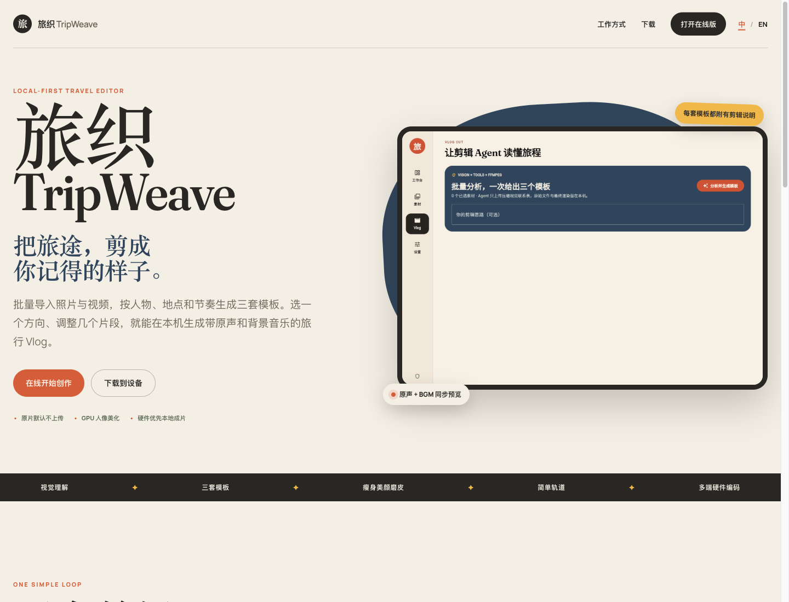

# TripWeave

[](https://github.com/JimiZhou/tripweave/actions/workflows/ci.yml)
[](https://github.com/JimiZhou/tripweave/actions/workflows/release.yml)
[](LICENSE)

[中文](README.md) · [Architecture](docs/ARCHITECTURE.md) · [Configuration](docs/CONFIGURATION.md) · [Contributing](CONTRIBUTING.md)

TripWeave is a local-first, cross-platform travel Vlog editor built from one Flutter codebase. Import photos and videos, choose one of three generated plans, adjust clips and music on a compact timeline, and export a validated MP4 through a hardware-first FFmpeg/WebCodecs pipeline.

This repository contains the Flutter application and runner build definitions only. It does not contain an operations dashboard, hosted model service, private endpoint, API key, or marketing-site deployment source. The `web/` directory is the Flutter Web platform entrypoint, not a separate website repository.

## Screenshots

| Product page | Editor client |
| --- | --- |
|  |  |

## Highlights

- Android, Web, Windows, and macOS from one Flutter project.
- Batch media selection, local GPU portrait presets, and local rendering.
- Optional OpenAI-compatible vision and planning models with a ReAct editing loop.
- Three explainable plans, synchronized source audio and CC0 music preview, and a simple editable timeline.
- Persisted journey projects with clear missing-source behavior.
- Hardware probes for MediaCodec, WebCodecs, NVENC/QSV/AMF, and VideoToolbox, followed by safe software fallback and FFprobe validation.

## Privacy and configuration

The complete editing path works without a cloud service. When the optional agent is enabled, TripWeave sends a compressed contact sheet and media metadata for the explicit analysis request; the built-in loop does not upload original videos.

Public builds contain no model endpoint, API key, update server, or managed provisioning service. Users enter their own compatible endpoint and credentials in Settings. See [docs/CONFIGURATION.md](docs/CONFIGURATION.md).

## Builds

Official Android APKs, Web ZIP, Windows installer, and separate Apple Silicon and Intel macOS ZIPs are produced only by GitHub-hosted runners in [release.yml](.github/workflows/release.yml). Tags matching `v*` publish all artifacts and checksums to GitHub Releases. GitHub Pages is built from `main` by a separate runner workflow.

## Development

```bash
git clone https://github.com/JimiZhou/tripweave.git
cd tripweave
flutter pub get
flutter analyze
flutter test --exclude-tags=real-e2e
flutter run -d chrome
```

Local commands are for development; official packages are runner artifacts.

## License

TripWeave source code is licensed under the [MIT License](LICENSE). FFmpeg, FFmpeg Kit, fonts, and media metadata retain their upstream terms; see [THIRD_PARTY_NOTICES.md](THIRD_PARTY_NOTICES.md).
